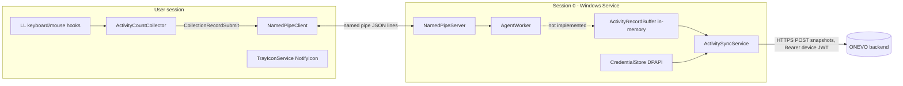

# 01 — Technology Stack & Architecture Report (T01)

| | |
|---|---|
| Application | ONEVO HRMS_TrayApp (product name in code: **ONEVO WorkPulse** agent) |
| Audited revision | `5cca93e` ("first commit") on `claude/magical-curie-y2y0r4` |
| Audit date | 2026-10-29 |
| Method | Full read of every source file (60 hand-written files), restore/build/test of non-MAUI projects on Linux, scratch experiments, Windows CI (see 05) |

## 1. Executive summary

The repository is an **early-stage scaffold**, not a feature-complete tray application.
Individual components exist (state machine, named-pipe IPC, activity collector, in-memory buffer,
backend sync), but **they are not wired together**: the Windows Service never registers the
buffer/sync/policy components, ignores records sent by the tray, and never leaves the
`Unenrolled` state; the tray never instantiates its collectors. There is **no login,
no enrollment, no clock-in/out, no break tracking and no durable offline queue**.

The application therefore cannot perform its core function end to end today, independent of
any defects in the individual components. See ISS-001..ISS-005 in the issue register.

## 2. Technology stack (verified)

| Layer | Technology | Evidence |
|---|---|---|
| Language | C# (`LangVersion=preview`, nullable enabled, warnings as errors) | `Directory.Build.props` |
| SDK | .NET SDK **10.0.300**, `rollForward: disable` | `global.json` |
| Service runtime | .NET 10, `net10.0-windows`, Worker SDK, hosted as a **Windows Service** ("ONEVO Agent Service") | `ONEVO.Agent.Service.csproj`, `Program.cs:8` |
| Tray runtime | **.NET MAUI** (`net10.0-windows10.0.19041.0`, `UseMaui`) **plus WinForms** (`UseWindowsForms`) for the `NotifyIcon` | `ONEVO.Agent.TrayApp.csproj` |
| Shared contracts | `net10.0` class library (IPC envelope, models) | `ONEVO.Agent.Shared` |
| IPC | Windows named pipe `ONEVO.Agent.Pipe.v1`, newline-delimited JSON envelopes | `Constants.cs`, `NamedPipeServer.cs`, `NamedPipeClient.cs` |
| Native interop | `user32`/`kernel32` P/Invoke: `SetWindowsHookEx` (WH_KEYBOARD_LL / WH_MOUSE_LL), `GetLastInputInfo`, `GetForegroundWindow` | `Interop/NativeMethods.cs` |
| Local secrets | DPAPI (`ProtectedData`, **LocalMachine** scope) file in `%ProgramData%\ONEVO\Agent\credential.dat` | `Security/CredentialStore.cs` |
| Backend API | HTTPS JSON, `POST /api/v1/monitoring/activity/snapshots`, Bearer device JWT | `Api/AgentApiRoutes.cs`, `Sync/ActivitySyncService.cs` |
| MVVM | CommunityToolkit.Mvvm 8.4.0 (view models are placeholders) | `ViewModels/*` |
| Tests | xUnit 2.9.3, two test projects, 26 tests (state machine + IPC envelope) | `tests/` |

## 3. Project structure

```
ONEVO.Agent.slnx
├── ONEVO.Agent.Shared      net10.0          IPC envelope/messages, models, constants
├── ONEVO.Agent.Service     net10.0-windows  Windows Service (Session 0)
│   ├── AgentWorker.cs           hosted service; handles IPC StatusRequest only
│   ├── AgentStateMachine.cs     Unenrolled/Stopped/Active/Paused/Locked
│   ├── IPC/                     NamedPipeServer + NamedPipeAuthenticator
│   ├── Buffer/                  ActivityRecordBuffer (in-memory)        [NOT REGISTERED]
│   ├── Sync/                    ActivitySyncService (BackgroundService) [NOT REGISTERED]
│   ├── Policy/                  PolicyCache                             [NOT REGISTERED]
│   ├── Security/                CredentialStore (DPAPI), DeviceIdentityStore
│   └── Configuration/           AgentOptions + validation
├── ONEVO.Agent.TrayApp     MAUI + WinForms (interactive user session)
│   ├── App.xaml.cs              starts tray icon + pipe client
│   ├── Services/                NamedPipeClient, TrayIconService (NotifyIcon), NotificationService (log only)
│   ├── Collectors/              ActivityCountCollector, CollectorCoordinator [NOT REGISTERED]
│   ├── Security/PrivacyScrubber process-name / idle helpers
│   └── Views/ViewModels         Login / Status / PhotoCapture — placeholder pages only
└── tests/                  Service.Tests (state machine), Shared.Tests (envelope)
```

Entry points: `ONEVO.Agent.Service/Program.cs` (generic host) and `MauiProgram.CreateMauiApp` → `App.CreateWindow`.

## 4. Intended vs. actual runtime architecture



Dotted/marked links do not exist in code. What actually runs today:

1. Service starts, pipe server listens; state machine = `Unenrolled` forever (no code calls `TryTransition`; `ForceMonitoringActive` is declared but unused).
2. Tray starts, shows a `NotifyIcon`, connects to the pipe, completes the nonce handshake, sends `StatusRequest`, receives `Unenrolled` → tooltip "Setup Required".
3. Nothing else happens: no collector is constructed, no policy is pushed, nothing is buffered or uploaded.

## 5. Lifecycle map

| Event | Service | Tray |
|---|---|---|
| Boot / logon | Started by SCM (start type not defined — no installer) | No autostart mechanism exists (no installer / Run key / scheduled task) |
| Tray start before service | — | Originally: 5 attempts then gave up (ISS-013). **Fixed:** retries indefinitely, backoff capped at 30 s |
| Service restart / upgrade | In-memory buffer lost (ISS-004, open) | Originally never reconnected (ISS-013). **Fixed:** reconnects automatically |
| Lock / unlock, sleep / hibernate | No handling (`SessionSwitch`/power events not subscribed) | No handling; snapshot timer fires once on resume |
| Logoff / shutdown | Final flush now bounded to 5 s (ISS-021, fixed) | Window `Destroying` async-void disposal; dispose made non-throwing (ISS-035, fixed) |
| Force kill | All buffered data lost | Hooks released by OS |
| Multiple instances | SCM guarantees one service | **No single-instance guard** (ISS-016) |

## 6. Data flow & storage

| Data | Produced | Stored | Leaves device |
|---|---|---|---|
| Keyboard/mouse **counts** per interval, active/idle seconds, intensity, foreground **process file name** | Tray collector | Not stored by tray; Service buffer is RAM-only (cap 5,000 records) | Yes, to `/api/v1/monitoring/activity/snapshots` (when wired) |
| Device JWT | (nothing writes it yet) | `%ProgramData%\ONEVO\Agent\credential.dat` (DPAPI LocalMachine) | As Bearer header |
| Device identity (DeviceId, AgentId, TenantId) | (nothing writes it yet) | `%ProgramData%\ONEVO\Agent\identity.json` (plaintext) | No |
| Policy | Hard-coded default (`PolicyCache.CreateDefault`) | RAM | No |
| Logs | Both | Service: console/EventLog (host defaults); Tray: **Debug provider only** (nothing in release) | No |

Privacy design is sound in intent: hooks never read key codes or coordinates; window titles and paths are never collected (`PrivacyScrubber`).

## 7. Dependency inventory

| Package | Version | Used by | Latest seen on nuget.org (2026-10-29) | Known vulnerabilities |
|---|---|---|---|---|
| Microsoft.Extensions.Hosting | 10.0.0 | Service | 10.0.14 | none reported |
| Microsoft.Extensions.Hosting.WindowsServices | 10.0.0 | Service | 10.0.14 | none reported |
| Microsoft.Extensions.Http | 10.0.0 | Service | 10.0.14 | none reported |
| System.Security.Cryptography.ProtectedData | **9.0.0** (major mismatch) | Service | 10.0.14 | none reported |
| CommunityToolkit.Mvvm | 8.4.0 | Tray | — (not restorable on Linux) | not checked |
| Microsoft.Maui.Controls | 10.0.20 | Tray | — (not restorable on Linux) | not checked |
| Microsoft.NET.Test.Sdk / xunit / xunit.runner.visualstudio / coverlet.collector | 17.12.0 / 2.9.3 / 2.8.2 / 6.0.2 | tests | 18.11.0 / — / 4.0.1 / 10.1.0 | none reported |

Source: `dotnet list package --vulnerable --include-transitive` and `--outdated` against nuget.org. Native dependencies: `user32.dll`, `kernel32.dll` only.

## 8. Build status

| Project | Linux (SDK 10.0.113, `EnableWindowsTargeting`) | Windows CI (SDK 10.0.300, pinned) |
|---|---|---|
| Shared, Service, test projects | Build clean (warnings as errors); all tests pass | Build clean; **89/89 tests pass** (run 203); versioned service publish artifact produced |
| TrayApp | Not buildable (MAUI Windows) | **Produces no binary**: "Build succeeded" in ~0.4 s with nothing compiled; no `Platforms/Windows` head exists (ISS-005, verified) |

At audit time (`5cca93e`) the committed `obj/` state already showed this: no MAUI packages restored, no `Microsoft.Maui.*` implicit usings, no `bin/` output.

## 9. Risk summary

| Risk | Level |
|---|---|
| Core workflows (login, attendance, activity upload) not implemented / not wired | **Blocker** |
| Tray application produces no executable (ISS-005) | **Blocker** |
| Activity data not durable; several data-loss paths in sync | High |
| Local credential readable by any local user; IPC has no real authentication | High |
| Windows lifecycle (reconnect, sleep, lock, single instance) unhandled | High |
| No CI, no installer, no release versioning | High |
